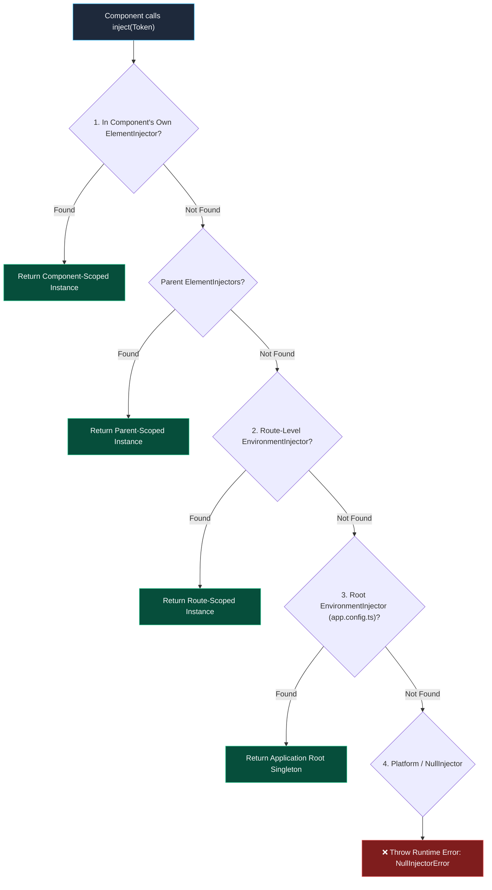
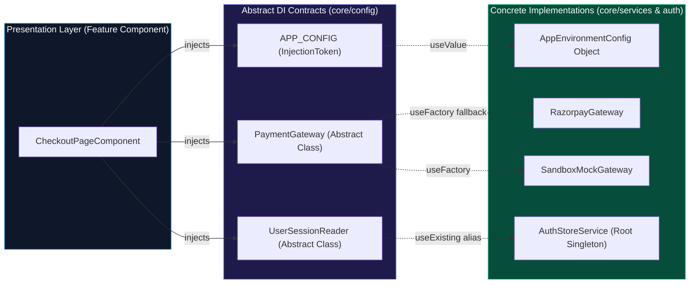
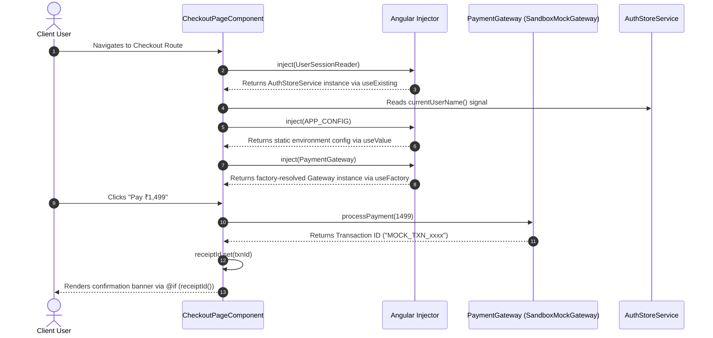

# Production-Grade Dependency Injection in Angular 22+

> **Mandatory Architecture Directive**: This project strictly adheres to the latest **Angular version 22+** conventions, utilizing standalone components, the functional `inject()` API, reactive Signals, modern control flow (`@if`), `ChangeDetectionStrategy.OnPush`, and sleek dark-themed component styling. This implementation focuses exclusively on the **"Production Level"** DI patterns (`InjectionToken`, `useFactory`, and `useExisting`).

---

## Table of Contents

- [1. Mandatory Angular 22+ Standards](#1-mandatory-angular-22-standards)
- [2. Dependency Injection Overview & Core Motivation](#2-dependency-injection-overview--core-motivation)
  - [2.1 What is Dependency Injection in Angular?](#21-what-is-dependency-injection-in-angular)
  - [2.2 Real-World Pitfalls Without DI](#22-real-world-pitfalls-without-di)
- [3. Angular Injector Hierarchy](#3-angular-injector-hierarchy)
  - [3.1 Two-Tier Injector Architecture](#31-two-tier-injector-architecture)
  - [3.2 Injector Resolution Flowchart](#32-injector-resolution-flowchart)
- [4. Production-Level DI Patterns (Architectural Core)](#4-production-level-di-patterns-architectural-core)
  - [4.1 Pattern 1: InjectionToken & `useValue`](#41-pattern-1-injectiontoken--usevalue)
  - [4.2 Pattern 2: Abstract Class & Dynamic `useFactory`](#42-pattern-2-abstract-class--dynamic-usefactory)
  - [4.3 Pattern 3: Read-Only Facade & `useExisting`](#43-pattern-3-read-only-facade--useexisting)
- [5. System Architecture & Flow Line Diagrams](#5-system-architecture--flow-line-diagrams)
  - [5.1 Contract-Driven Inversion of Control Diagram](#51-contract-driven-inversion-of-control-diagram)
  - [5.2 Provider Wiring Flow in `app.config.ts`](#52-provider-wiring-flow-in-appconfigts)
  - [5.3 Runtime Checkout Component Execution Sequence](#53-runtime-checkout-component-sequence)
- [6. Project File Structure & Implementation](#6-project-file-structure--implementation)
  - [Step A: Defining Tokens & Abstract Contracts](#step-a-defining-tokens--abstract-contracts)
  - [Step B: Concrete Implementations](#step-b-concrete-implementations)
  - [Step C: Read-Only Facade via `useExisting`](#step-c-read-only-facade-via-useexisting)
  - [Step D: Wiring Providers in `app.config.ts`](#step-d-wiring-providers-in-appconfigts)
  - [Step E: Consuming Clean Contracts in `CheckoutPageComponent`](#step-e-consuming-clean-contracts-in-checkoutpagecomponent)
- [7. Dark Theme UI Design System](#7-dark-theme-ui-design-system)
- [8. Critical Edge Cases, Traps & Best Practices](#8-critical-edge-cases-traps--best-practices)
  - [8.1 `useClass` vs `useExisting` Singleton Trap](#81-useclass-vs-useexisting-singleton-trap)
  - [8.2 Circular Dependency Trap (`NG0200`)](#82-circular-dependency-trap-ng0200)
  - [8.3 Injection Context Restriction (`NG0203`)](#83-injection-context-restriction-ng0203)
  - [8.4 Tree-Shaking Scoping (`providedIn: 'root'` vs `providers: []`)](#84-tree-shaking-scoping-providedin-root-vs-providers-)
  - [8.5 Memory Cleanup with `DestroyRef`](#85-memory-cleanup-with-destroyref)
- [9. Testing with Dependency Injection](#9-testing-with-dependency-injection)
- [10. Build and Verification Guide](#10-build-and-verification-guide)

---

## 1. Mandatory Angular 22+ Standards

This application is strictly configured and verified under **Angular 22+** (`@angular/core: ^22.3.0`):

1. **Strictly Standalone**: All components, directives, and pipes are standalone. NgModules are completely eliminated.
2. **Functional `inject()` API**: Constructor dependency injection is replaced with the functional `inject()` API for cleaner type inference, reduced boilerplate, and composition compatibility.
3. **Reactive Signals**: Reactive state management is driven by Angular Signals (`signal`, `asReadonly`, `computed`), providing fine-grained reactivity.
4. **Built-in Control Flow**: Templates use native `@if`, `@else`, `@for`, and `@switch` blocks rather than legacy `*ngIf` and `*ngFor` directives.
5. **Change Detection**: All components enforce `changeDetection: ChangeDetectionStrategy.OnPush`.
6. **Dark Theme Components**: All components feature native dark-theme styles (`#0b0f19`, `#161e2e`, glowing accents, accessible contrast).
7. **Production Scope**: Focuses strictly on production-tier DI mechanisms (`InjectionToken`, `useFactory`, `useExisting`), ensuring enterprise-grade loose coupling.

---

## 2. Dependency Injection Overview & Core Motivation

### 2.1 What is Dependency Injection in Angular?

Dependency Injection (DI) is a software design pattern where a class requests external dependencies rather than instantiating them directly using the `new` operator. Angular maintains a built-in **Hierarchical Injector System** that:
- Instantiates service classes and manages singletons.
- Caches instances according to their resolution scope (`EnvironmentInjector` vs `ElementInjector`).
- Automatically resolves complex nested dependency graphs.
- Hands fully constructed objects to any consumer executing within an **Injection Context** via `inject()`.

### 2.2 Real-World Pitfalls Without DI

```typescript
// ❌ WITHOUT DEPENDENCY INJECTION (Tight Coupling & Fragile Architecture)
export class OrderComponent {
  // Component must know how to build the entire transitive dependency chain!
  private http = new HttpClient(new HttpXhrBackend());
  private logger = new LoggerService('PROD');
  private orderService = new OrderService(this.http, this.logger);
}
```

1. **Constructor Explosion**: If `OrderService` adds a new parameter (e.g., `CacheService`), every component that manually calls `new OrderService(...)` breaks and requires manual updating across dozens of files.
2. **No Shared State**: Calling `new CartService()` inside `NavbarComponent` and `new CartService()` inside `CheckoutComponent` creates two completely separate objects. Adding an item in checkout never updates the navbar.
3. **Impossible Unit Testing**: Hardcoded `new PaymentApiService()` calls cannot be swapped for mock or stub implementations during automated testing without firing actual HTTP calls or real financial transactions.
4. **Bloated Bundle Sizes**: Unused services cannot be tree-shaken (dead-code eliminated) by the compiler when manually imported and instantiated throughout the codebase.

---

## 3. Angular Injector Hierarchy

### 3.1 Two-Tier Injector Architecture

Angular resolves dependencies by traversing a two-tier hierarchy from bottom to top:

1. **ElementInjector Hierarchy**: Created automatically for DOM elements, directives, and components (configured via `@Component({ providers: [...] })`).
2. **EnvironmentInjector Hierarchy**: Configured for application-wide root services (`@Injectable({ providedIn: 'root' })` or `app.config.ts`) and lazy-loaded routes (`providers: [...]` in route definitions).

### 3.2 Injector Resolution Flowchart



---

## 4. Production-Level DI Patterns (Architectural Core)

In enterprise production environments, components must never couple to environment URLs, API keys, or concrete vendor SDKs. Instead, architecture contracts decouple the consumer from the provider.

### 4.1 Pattern 1: InjectionToken & `useValue`

TypeScript interfaces do not exist at JavaScript runtime (they are erased during compilation). Therefore, a standard interface cannot be used directly as a runtime DI lookup key.

An `InjectionToken<T>` provides a type-safe token that persists at runtime:

```typescript
// Token definition
export interface AppEnvironmentConfig {
  readonly apiBaseUrl: string;
  readonly enableDebugLogs: boolean;
  readonly maxUploadSizeMb: number;
}
export const APP_CONFIG = new InjectionToken<AppEnvironmentConfig>('APP_CONFIG');

// Provider registration in app.config.ts
{
  provide: APP_CONFIG,
  useValue: {
    apiBaseUrl: 'https://api.example.in/v2',
    enableDebugLogs: false,
    maxUploadSizeMb: 10
  }
}
```

### 4.2 Pattern 2: Abstract Class & Dynamic `useFactory`

An `abstract class` serves dual purposes in TypeScript:
1. It functions as a **compile-time type contract**.
2. It generates a concrete JavaScript reference that serves as a **runtime DI token**.

By pairing an abstract class with `useFactory`, Angular determines dynamically at application boot-up which concrete class to instantiate:

```typescript
// Abstract contract
export abstract class PaymentGateway {
  abstract processPayment(amountInr: number): Promise<string>;
}

// Factory registration in app.config.ts
{
  provide: PaymentGateway,
  useFactory: () => {
    const config = inject(APP_CONFIG);
    return config.enableDebugLogs
      ? new SandboxMockGateway()
      : new RazorpayGateway();
  }
}
```

### 4.3 Pattern 3: Read-Only Facade & `useExisting`

Following the **Interface Segregation Principle (ISP)** and the **Principle of Least Privilege**, presentation components should only be exposed to read methods (such as reading user details), while write methods (like `logout()` or `setTokens()`) must remain restricted.

Using `useExisting` aliases an abstract interface to an already existing singleton instance:

```typescript
// Abstract read contract
export abstract class UserSessionReader {
  abstract readonly currentUserName: Signal<string | null>;
}

// Aliasing in app.config.ts
{
  provide: UserSessionReader,
  useExisting: AuthStoreService
}
```

> [!WARNING]
> Never use `useClass: AuthStoreService` for aliasing! `useClass` will instantiate a **second separate instance** of `AuthStoreService`, breaking state synchronization across components. Always use `useExisting`.

---

## 5. System Architecture & Flow Line Diagrams

### 5.1 Contract-Driven Inversion of Control Diagram



### 5.2 Provider Wiring Flow in `app.config.ts`

```mermaid
flowchart TD
    Config["app.config.ts"] --> P1["1. useValue: APP_CONFIG"]
    Config --> P2["2. useFactory: PaymentGateway"]
    Config --> P3["3. useExisting: UserSessionReader"]

    P1 --> V["Static Environment Configuration Object"]
    P2 --> Cond{"config.enableDebugLogs?"}
    Cond -- "true" --> Mock["SandboxMockGateway"]
    Cond -- "false" --> Prod["RazorpayGateway"]
    P3 --> Alias["Map to existing AuthStoreService singleton"]

    style Config fill:#1e293b,stroke:#38bdf8,color:#ffffff
    P1 fill:#0f172a,stroke:#38bdf8,color:#cbd5e1
    P2 fill:#0f172a,stroke:#fbbf24,color:#cbd5e1
    P3 fill:#0f172a,stroke:#c084fc,color:#cbd5e1
```

### 5.3 Runtime Checkout Component Execution Sequence



---

## 6. Project File Structure & Implementation

```
src/
├── app/
│   ├── core/
│   │   ├── auth/
│   │   │   └── auth-store.service.ts         # UserSessionReader & AuthStoreService
│   │   ├── config/
│   │   │   └── app-tokens.ts                 # APP_CONFIG & PaymentGateway contracts
│   │   └── services/
│   │       └── payment-gateways.ts           # RazorpayGateway & SandboxMockGateway
│   ├── features/
│   │   └── checkout/
│   │       ├── checkout-page.component.ts    # DI Consumer Component
│   │       ├── checkout-page.component.html  # Dark theme UI with @if control flow
│   │       ├── checkout-page.component.css   # Dark theme scoped styles
│   │       └── checkout-page.component.spec.ts # Vitest unit test suite with DI overrides
│   ├── app.config.ts                         # Production provider registrations
│   ├── app.routes.ts                         # Route definitions
│   ├── app.ts                                # Root application shell
│   ├── app.html                              # Dark theme shell template
│   ├── app.css                               # Root shell styles
│   └── app.spec.ts                           # Root application unit tests
├── styles.css                                # Global dark theme baseline
└── main.ts                                   # Application bootstrap entrypoint
```

### Step A: Defining Tokens & Abstract Contracts

Location: `src/app/core/config/app-tokens.ts`

```typescript
import { InjectionToken } from '@angular/core';

export interface AppEnvironmentConfig {
  readonly apiBaseUrl: string;
  readonly enableDebugLogs: boolean;
  readonly maxUploadSizeMb: number;
}

// 1. InjectionToken allows Angular DI to inject plain TypeScript interfaces and objects
export const APP_CONFIG = new InjectionToken<AppEnvironmentConfig>('APP_CONFIG');

// 2. Abstract class acts as both a TypeScript interface AND a runtime DI token
export abstract class PaymentGateway {
  abstract processPayment(amountInr: number): Promise<string>;
}
```

### Step B: Concrete Implementations

Location: `src/app/core/services/payment-gateways.ts`

```typescript
import { Injectable, inject } from '@angular/core';
import { APP_CONFIG, PaymentGateway } from '../config/app-tokens';

@Injectable()
export class RazorpayGateway implements PaymentGateway {
  private readonly config = inject(APP_CONFIG);

  async processPayment(amountInr: number): Promise<string> {
    if (this.config.enableDebugLogs) {
      console.log(`[RazorpayGateway] Calling Razorpay via ${this.config.apiBaseUrl} for ₹${amountInr}`);
    }
    await new Promise((resolve) => setTimeout(resolve, 800));
    return `RZP_TXN_${Date.now()}`;
  }
}

@Injectable()
export class SandboxMockGateway implements PaymentGateway {
  async processPayment(amountInr: number): Promise<string> {
    console.log(`[SandboxMockGateway] [SANDBOX] Simulated ₹${amountInr} payment`);
    await new Promise((resolve) => setTimeout(resolve, 600));
    return `MOCK_TXN_${Math.floor(1000 + Math.random() * 9000)}`;
  }
}
```

### Step C: Read-Only Facade via `useExisting`

Location: `src/app/core/auth/auth-store.service.ts`

```typescript
import { Injectable, Signal, signal } from '@angular/core';

// Abstract contract exposing ONLY read operations (Principle of Least Privilege)
export abstract class UserSessionReader {
  abstract readonly currentUserName: Signal<string | null>;
}

@Injectable({
  providedIn: 'root',
})
export class AuthStoreService implements UserSessionReader {
  private readonly userSignal = signal<string | null>('Aarav Mehta');

  // Public read-only signal exposed through UserSessionReader
  readonly currentUserName = this.userSignal.asReadonly();

  // Sensitive write methods hidden from components that only inject UserSessionReader
  login(name: string): void {
    this.userSignal.set(name);
  }

  logout(): void {
    this.userSignal.set(null);
  }
}
```

### Step D: Wiring Providers in `app.config.ts`

Location: `src/app/app.config.ts`

```typescript
import { ApplicationConfig, inject, provideBrowserGlobalErrorListeners } from '@angular/core';
import { provideRouter } from '@angular/router';
import { routes } from './app.routes';
import { APP_CONFIG, PaymentGateway } from './core/config/app-tokens';
import { RazorpayGateway, SandboxMockGateway } from './core/services/payment-gateways';
import { AuthStoreService, UserSessionReader } from './core/auth/auth-store.service';

const isProduction = false; // Toggle to switch implementations cleanly

export const appConfig: ApplicationConfig = {
  providers: [
    provideBrowserGlobalErrorListeners(),
    provideRouter(routes),

    // 1. useValue: Inject static environment configuration
    {
      provide: APP_CONFIG,
      useValue: {
        apiBaseUrl: 'https://api.example.in/v2',
        enableDebugLogs: !isProduction,
        maxUploadSizeMb: 10,
      },
    },

    // 2. useFactory: Dynamically choose which gateway class to instantiate
    {
      provide: PaymentGateway,
      useFactory: () => {
        const config = inject(APP_CONFIG);
        return config.enableDebugLogs
          ? new SandboxMockGateway()
          : new RazorpayGateway();
      },
    },

    // 3. useExisting: Maps UserSessionReader to the exact same AuthStoreService singleton
    {
      provide: UserSessionReader,
      useExisting: AuthStoreService,
    },
  ],
};
```

### Step E: Consuming Clean Contracts in `CheckoutPageComponent`

Location: `src/app/features/checkout/checkout-page.component.ts`

```typescript
import { ChangeDetectionStrategy, Component, inject, signal } from '@angular/core';
import { APP_CONFIG, PaymentGateway } from '../../core/config/app-tokens';
import { UserSessionReader } from '../../core/auth/auth-store.service';

@Component({
  selector: 'app-checkout-page',
  imports: [],
  templateUrl: './checkout-page.component.html',
  styleUrl: './checkout-page.component.css',
  changeDetection: ChangeDetectionStrategy.OnPush,
})
export class CheckoutPageComponent {
  // Component depends on abstract contracts, never concrete implementations
  protected readonly userReader = inject(UserSessionReader);
  private readonly gateway = inject(PaymentGateway);
  protected readonly config = inject(APP_CONFIG);

  protected readonly receiptId = signal<string | null>(null);
  protected readonly isProcessing = signal<boolean>(false);
  protected readonly paymentError = signal<string | null>(null);

  async payNow(): Promise<void> {
    this.isProcessing.set(true);
    this.paymentError.set(null);
    try {
      const txnId = await this.gateway.processPayment(1499);
      this.receiptId.set(txnId);
    } catch {
      this.paymentError.set('Payment could not be completed. Please try again.');
    } finally {
      this.isProcessing.set(false);
    }
  }

  resetReceipt(): void {
    this.receiptId.set(null);
    this.paymentError.set(null);
  }
}
```

---

## 7. Dark Theme UI Design System

The application applies a cohesive dark theme palette across all layers:

| Element | Color Hex / Style | Purpose |
| :--- | :--- | :--- |
| **App Background** | `#0b0f19` | Low-luminance comfortable workspace |
| **Card Surface** | `#161e2e` to `#0f172a` gradient | Layered elevation with depth |
| **Border Highlights** | `#1e293b` & `#334155` | Subtle separation without visual noise |
| **Primary Accent** | `#38bdf8` (Sky) | Tokens, badges, and primary highlights |
| **Secondary Accent**| `#818cf8` (Indigo) | Facade tokens and subheadings |
| **Success Accent** | `#34d399` (Emerald) | Active status pills and verified receipts |
| **Warning / Mock** | `#fbbf24` (Amber) | Sandbox mock indicators |
| **CTA Button** | `#2563eb` with glow | High-contrast interactive triggers |

---

## 8. Critical Edge Cases, Traps & Best Practices

### 8.1 `useClass` vs `useExisting` Singleton Trap

```typescript
// ❌ CRITICAL MISTAKE:
{ provide: UserSessionReader, useClass: AuthStoreService }
// Result: Angular creates a SECOND independent instance of AuthStoreService!
// Updating auth state in one component will NOT reflect in UserSessionReader.

// ✅ CORRECT IMPLEMENTATION:
{ provide: UserSessionReader, useExisting: AuthStoreService }
// Result: Aliases UserSessionReader to the EXACT SAME existing singleton.
```

### 8.2 Circular Dependency Trap (`NG0200`)

If `ServiceA` calls `inject(ServiceB)` and `ServiceB` calls `inject(ServiceA)`, Angular fails at runtime with `NG0200: Circular dependency detected`.
- **Solution A**: Extract shared functionality into a standalone `ServiceC` that both `ServiceA` and `ServiceB` inject.
- **Solution B**: Pass required parameters as function arguments rather than injecting sibling services.

### 8.3 Injection Context Restriction (`NG0203`)

The `inject()` function can only be executed synchronously within an active **Injection Context**:
- Class field initializers: `private readonly logger = inject(LoggerService);`
- Class constructors.
- Provider factory functions: `useFactory: () => { ... }`.
- Functional route guards and resolvers.

Calling `inject()` inside regular asynchronous methods or event handlers triggers `NG0203`. If dynamic injection is required, wrap the call with `runInInjectionContext(injector, () => inject(MyService))`.

### 8.4 Tree-Shaking Scoping (`providedIn: 'root'` vs `providers: []`)

- Services configured with `@Injectable({ providedIn: 'root' })` are **tree-shakable**: if no component or service references them, the production bundler drops them from the output artifact.
- Services explicitly declared in `app.config.ts` `providers: [...]` are **always included** in the final bundle, even if unreferenced elsewhere.

### 8.5 Memory Cleanup with `DestroyRef`

In Angular 22+, root singletons remain active for the lifespan of the browser tab. For route-scoped or component-scoped services, inject `DestroyRef` to register clean-up handlers for intervals, WebSockets, or subscriptions:

```typescript
export class DataFeedService {
  private destroyRef = inject(DestroyRef);

  init(): void {
    const timer = setInterval(() => this.poll(), 1000);
    this.destroyRef.onDestroy(() => clearInterval(timer));
  }
}
```

---

## 9. Testing with Dependency Injection

Because components depend on abstract contracts rather than concrete classes, unit testing with Vitest is completely decoupled and fast:

```typescript
await TestBed.configureTestingModule({
  imports: [CheckoutPageComponent],
  providers: [
    // 1. Swap APP_CONFIG with test mock
    {
      provide: APP_CONFIG,
      useValue: { apiBaseUrl: 'https://test-api.dev', enableDebugLogs: true, maxUploadSizeMb: 15 }
    },
    // 2. Swap PaymentGateway with test mock
    {
      provide: PaymentGateway,
      useValue: { processPayment: async () => 'TEST_TXN_9999' }
    },
    // 3. Swap UserSessionReader with test signal
    {
      provide: UserSessionReader,
      useValue: { currentUserName: signal('Test User').asReadonly() }
    }
  ]
}).compileComponents();
```

---

## 10. Build and Verification Guide

### 10.1 Running the Production Build

```powershell
npm run build
```
Generates optimized, tree-shaken static assets inside `dist/Dependency_Injection`.

### 10.2 Running Unit Tests

```powershell
npm test
```
Executes the Vitest test suite testing component lifecycle, DI contract resolution, mock dispatching, and signal state updates.

### 10.3 Serving Locally

```powershell
npm start
```
Starts the Angular live development server at `http://localhost:4200/`.
