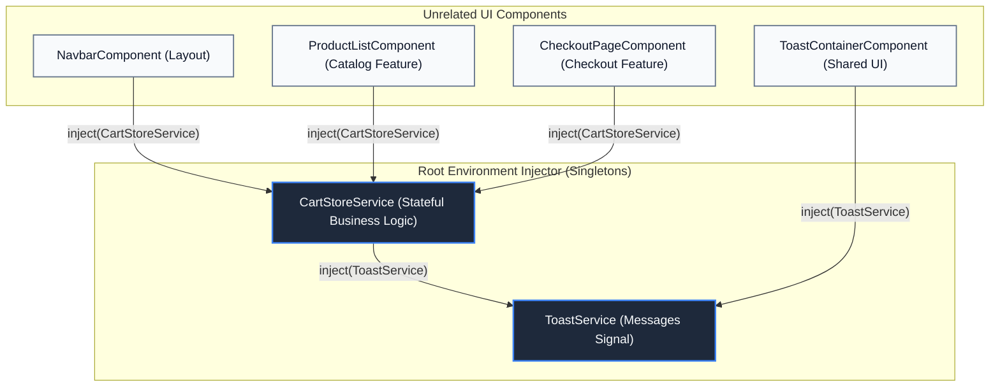
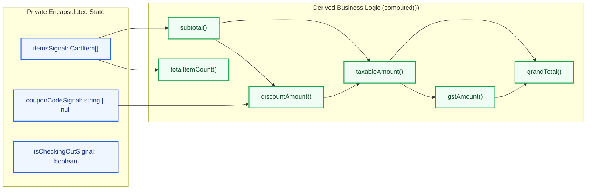
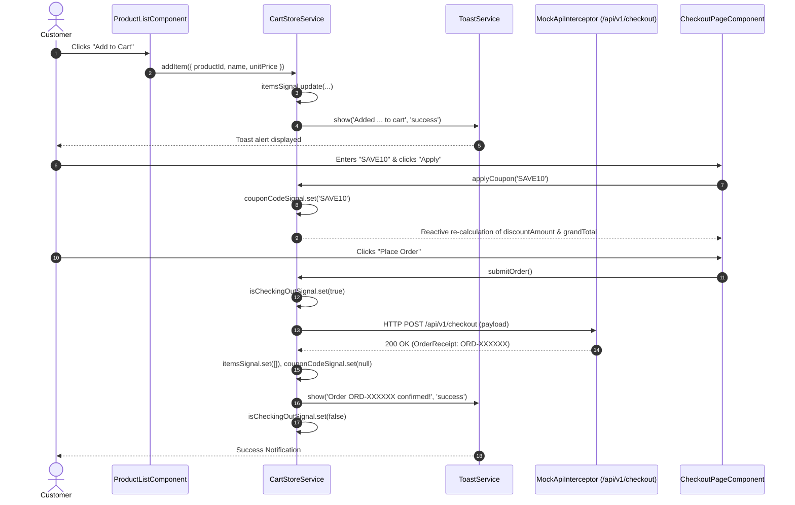

# Angular 22+ Shared Services Architecture (Production-Level Implementation)

> **Mandatory Instruction & Strict Version Adherence**  
> This project strictly adheres to **Angular version 22+** standards, conventions, and idioms. All implementations utilize modern **Standalone Components**, the function-based **`inject()` API**, native **Angular Signals (`signal()`, `computed()`, `.asReadonly()`)**, **OnPush change detection**, new control flow syntax (`@for`, `@if`, `@empty`), and functional HTTP interceptors via `provideHttpClient()`. Legacy decorators (e.g., constructor-based DI parameter injection, `NgModule`, `@Input()` / `@Output()` chains for global state) are strictly avoided.

---

## Table of Contents

1. [Architectural Overview: What is a Shared Service?](#1-architectural-overview-what-is-a-shared-service)
2. [Why Shared Services are Required (Problems Without Them)](#2-why-shared-services-are-required-problems-without-them)
3. [How Dependency Injection Works in Angular 22+](#3-how-dependency-injection-works-in-angular-22)
4. [Service Scoping Matrix: Root vs Route vs Component](#4-service-scoping-matrix-root-vs-route-vs-component)
5. [Production Architecture: Stateful Business Logic with Signals](#5-production-architecture-stateful-business-logic-with-signals)
6. [Flow Line & Sequence Diagrams](#6-flow-line--sequence-diagrams)
   - [Diagram 1: Component & Service Injection Topology](#diagram-1-component--service-injection-topology)
   - [Diagram 2: Reactive State & Computed Calculation Flow](#diagram-2-reactive-state--computed-calculation-flow)
   - [Diagram 3: End-to-End Order Checkout Sequence](#diagram-3-end-to-end-order-checkout-sequence)
7. [Complete Codebase Walkthrough](#7-complete-codebase-walkthrough)
   - [Domain Models (`cart.model.ts`)](#domain-models-cartmodelts)
   - [Stateless Notification Service (`toast.service.ts`)](#stateless-notification-service-toastservicets)
   - [Production Shared Service (`cart-store.service.ts`)](#production-shared-service-cart-storeservicets)
   - [Mock API Interceptor (`mock-api.interceptor.ts`)](#mock-api-interceptor-mock-apiinterceptorts)
   - [Header Navbar Component (`navbar.component.ts`)](#header-navbar-component-navbarcomponentts)
   - [Product Catalog Component (`product-list.component.ts`)](#product-catalog-component-product-listcomponentts)
   - [Checkout Summary Page (`checkout-page.component.ts`)](#checkout-summary-page-checkout-pagecomponentts)
   - [Global Toast Container (`toast-container.component.ts`)](#global-toast-container-toast-containercomponentts)
   - [Application Configuration (`app.config.ts`)](#application-configuration-appconfigts)
8. [Architectural Tradeoffs: Advantages vs Disadvantages](#8-architectural-tradeoffs-advantages-vs-disadvantages)
9. [Real-World Enterprise Patterns](#9-real-world-enterprise-patterns)
10. [Development, Testing & Verification Guide](#10-development-testing--verification-guide)

---

## 1. Architectural Overview: What is a Shared Service?

A **shared service** in Angular is an injectable TypeScript class decorated with `@Injectable({ providedIn: 'root' })` that acts as a **single source of truth** for common business logic, shared application state, or reusable utilities across multiple components and features.

In modern **Angular 22+**, shared services leverage:
1. **Dependency Injection (`inject()`)**: Replaces verbose constructor injection with composable, type-safe injection anywhere in injection contexts.
2. **Angular Signals (`signal()`, `computed()`, `.asReadonly()`)**: Enables fine-grained reactivity without the overhead of manual subscription management or accidental zone-related performance bottlenecks.
3. **Encapsulated State Mutation**: Private writable signals prevent external consumers from directly corrupting data structures, exposing strictly read-only signals and explicit business methods.

---

## 2. Why Shared Services are Required (Problems Without Them)

Without shared services, components that live in different branches of the component tree (such as a top navigation bar, a product catalog card, and a checkout summary page) have no clean way to share state or business rules.

### Without Shared Services (Prop Drilling & Duplication)

```
┌───────────────────────────────────────┐
│           AppRootComponent            │ <--- Forced to manage state it doesn't even use!
└──────────────┬─────────────────┬──────┘
               │ @Input()        │ @Input()
               ▼                 ▼
        ┌─────────────┐   ┌─────────────┐
        │   Navbar    │   │  Dashboard  │
        └─────────────┘   └──────┬──────┘
                                 │ @Input()
                                 ▼
                          ┌─────────────┐
                          │  CartBadge  │ <--- Needs cart count from 3 levels up
                          └─────────────┘
```

### Real-World Pitfalls Avoided:
* **Prop Drilling**: Passing data through 4 or 5 intermediate parent components that do not even need the data just to reach a deeply nested child component.
* **Duplicated Business Rules**: Writing tax calculation, discount eligibility, or permission checks inside multiple separate components. When a rule changes, one component is updated while others continue calculating stale or wrong numbers.
* **Out-of-Sync UI State**: When a user adds an item to a shopping cart in one component, the cart counter in the header fails to update because each component holds its own isolated copy of the data.
* **Bloated Components**: Components expand to hundreds of lines because they mix presentation rendering with HTTP requests, data transformation, and error handling.

---

## 3. How Dependency Injection Works in Angular 22+

When a class is decorated with `@Injectable({ providedIn: 'root' })`, Angular creates **one singleton instance** of that service for the entire application and registers it in the **root environment injector**.

```
┌────────────────────────────────────────────────────────┐
│               Root Environment Injector                │
│  ┌──────────────────────────────────────────────────┐  │
│  │           CartStoreService (Singleton)           │  │
│  └────────────────────────▲─────────────────────────┘  │
└───────────────────────────┼────────────────────────────┘
                            │ inject(CartStoreService)
          ┌─────────────────┼──────────────────┐
          │                 │                  │
┌─────────┴─────────┐ ┌─────┴─────────┐ ┌──────┴──────────────┐
│  NavbarComponent  │ │  ProductList  │ │ CheckoutPageComponent│
└───────────────────┘ └───────────────┘ └──────────────────────┘
```

* **Tree-Shakable by Default**: If no component, directive, or other service invokes `inject(CartStoreService)`, Angular's compiler completely tree-shakes and removes the service from the final production bundle.
* **Shared In-Memory State**: Every component calling `inject(CartStoreService)` receives the exact same in-memory instance, meaning state mutations triggered in `ProductListComponent` are instantaneously and reactively reflected in `NavbarComponent` and `CheckoutPageComponent`.

---

## 4. Service Scoping Matrix: Root vs Route vs Component

Not every shared service should live forever in `root`. Angular provides granular lifetime scoping:

| Scope | How to Configure | Lifetime & Behavior | When to Use |
| :--- | :--- | :--- | :--- |
| **Root Singleton** | `@Injectable({ providedIn: 'root' })` | Created once upon first injection; lives for the lifespan of the browser tab/session. | Global Auth state, user profile, shopping cart, global toast notifications, application caching. |
| **Route-Scoped** | `providers: [WizardService]` inside a route configuration | Created when entering the route; automatically destroyed when leaving the route. | Multi-step checkout, wizard flows, onboarding funnels where state should reset on route exit. |
| **Component-Scoped** | `providers: [TableStateService]` inside `@Component()` | A brand-new instance is created for each instance of that component and its child subtree. | Reusable widgets (e.g., two independent paginated data tables rendered on the same dashboard). |

---

## 5. Production Architecture: Stateful Business Logic with Signals

In large-scale enterprise applications, shared services manage complex domain state, derived calculations, API persistence, and cross-service orchestration.

### The Enterprise Shopping Cart & Pricing Engine
This implementation showcases three distinct consumers interacting with the singleton `CartStoreService`:
1. **Product Catalog**: Dispatches `addItem(product)` mutations to the shared cart.
2. **Top Navbar**: Reads the live count from `cartStore.totalItemCount()` derived signal.
3. **Checkout Page**: Consumes `items()`, `subtotal()`, `discountAmount()`, `gstAmount()`, `grandTotal()`, applies coupons via `applyCoupon()`, and submits orders via `submitOrder()`.
4. **Cross-Service DI**: `CartStoreService` injects both Angular's `HttpClient` and the shared `ToastService` to surface UI alerts upon mutations.

---

## 6. Flow Line & Sequence Diagrams

### Diagram 1: Component & Service Injection Topology



---

### Diagram 2: Reactive State & Computed Calculation Flow



---

### Diagram 3: End-to-End Order Checkout Sequence



---

## 7. Complete Codebase Walkthrough

### Domain Models (`cart.model.ts`)
[cart.model.ts](file:///d:/MyCode/My_GitHub/my-digital-space/Angular/concepts/Application_architecture/Shared_Services/src/app/shared/data-access/cart/cart.model.ts)
```typescript
export interface CartItem {
  productId: string;
  name: string;
  unitPrice: number;
  quantity: number;
}

export interface OrderReceipt {
  orderId: string;
  paidAmount: number;
  timestamp: string;
}
```

### Stateless Notification Service (`toast.service.ts`)
[toast.service.ts](file:///d:/MyCode/My_GitHub/my-digital-space/Angular/concepts/Application_architecture/Shared_Services/src/app/core/services/toast.service.ts)
```typescript
import { Injectable, signal } from '@angular/core';

export type ToastType = 'success' | 'error' | 'info';

export interface ToastMessage {
  id: number;
  text: string;
  type: ToastType;
}

@Injectable({
  providedIn: 'root'
})
export class ToastService {
  private readonly messagesSignal = signal<ToastMessage[]>([]);
  readonly messages = this.messagesSignal.asReadonly();

  show(text: string, type: ToastType = 'info', durationMs = 3000): void {
    const id = Date.now() + Math.floor(Math.random() * 1000);
    const newToast: ToastMessage = { id, text, type };

    this.messagesSignal.update((current) => [...current, newToast]);
    setTimeout(() => this.dismiss(id), durationMs);
  }

  dismiss(id: number): void {
    this.messagesSignal.update((current) =>
      current.filter((toast) => toast.id !== id)
    );
  }
}
```

### Production Shared Service (`cart-store.service.ts`)
[cart-store.service.ts](file:///d:/MyCode/My_GitHub/my-digital-space/Angular/concepts/Application_architecture/Shared_Services/src/app/shared/data-access/cart/cart-store.service.ts)
```typescript
import { Injectable, computed, inject, signal } from '@angular/core';
import { HttpClient } from '@angular/common/http';
import { catchError, finalize, of, tap } from 'rxjs';
import { CartItem, OrderReceipt } from './cart.model';
import { ToastService } from '../../../core/services/toast.service';

@Injectable({
  providedIn: 'root'
})
export class CartStoreService {
  private readonly http = inject(HttpClient);
  private readonly toast = inject(ToastService);
  private readonly GST_RATE = 0.18;

  // 1. Private Writable State (Encapsulated)
  private readonly itemsSignal = signal<CartItem[]>([
    { productId: 'PRD-01', name: 'Ergonomic Split Keyboard', unitPrice: 8500, quantity: 1 }
  ]);
  private readonly couponCodeSignal = signal<string | null>(null);
  private readonly isCheckingOutSignal = signal<boolean>(false);

  // 2. Public Read-Only Signals
  readonly items = this.itemsSignal.asReadonly();
  readonly appliedCoupon = this.couponCodeSignal.asReadonly();
  readonly isCheckingOut = this.isCheckingOutSignal.asReadonly();

  // 3. Derived Business Calculations (Memoized automatically by computed())
  readonly totalItemCount = computed(() =>
    this.itemsSignal().reduce((total, item) => total + item.quantity, 0)
  );

  readonly subtotal = computed(() =>
    this.itemsSignal().reduce((sum, item) => sum + item.unitPrice * item.quantity, 0)
  );

  readonly discountAmount = computed(() => {
    const code = this.couponCodeSignal();
    if (code === 'SAVE10') {
      return Math.round(this.subtotal() * 0.10);
    }
    return 0;
  });

  readonly taxableAmount = computed(() =>
    Math.max(0, this.subtotal() - this.discountAmount())
  );

  readonly gstAmount = computed(() =>
    Math.round(this.taxableAmount() * this.GST_RATE)
  );

  readonly grandTotal = computed(() =>
    this.taxableAmount() + this.gstAmount()
  );

  // 4. Business Mutation Methods
  addItem(product: Omit<CartItem, 'quantity'>): void {
    this.itemsSignal.update((currentItems) => {
      const existingIndex = currentItems.findIndex(
        (i) => i.productId === product.productId
      );
      if (existingIndex > -1) {
        return currentItems.map((item, idx) =>
          idx === existingIndex ? { ...item, quantity: item.quantity + 1 } : item
        );
      }
      return [...currentItems, { ...product, quantity: 1 }];
    });
    this.toast.show(`Added "${product.name}" to cart`, 'success');
  }

  removeItem(productId: string): void {
    this.itemsSignal.update((current) =>
      current.filter((item) => item.productId !== productId)
    );
    this.toast.show('Item removed from cart', 'info');
  }

  applyCoupon(rawCode: string): boolean {
    const normalized = rawCode.trim().toUpperCase();
    if (normalized === 'SAVE10') {
      this.couponCodeSignal.set(normalized);
      this.toast.show('Coupon SAVE10 applied (10% off)', 'success');
      return true;
    }
    this.toast.show('Invalid promo code', 'error');
    return false;
  }

  submitOrder(): void {
    if (this.itemsSignal().length === 0 || this.isCheckingOutSignal()) {
      return;
    }

    this.isCheckingOutSignal.set(true);

    const payload = {
      items: this.itemsSignal(),
      coupon: this.couponCodeSignal(),
      totalPaid: this.grandTotal()
    };

    this.http
      .post<OrderReceipt>('/api/v1/checkout', payload)
      .pipe(
        tap((receipt) => {
          this.itemsSignal.set([]);
          this.couponCodeSignal.set(null);
          this.toast.show(`Order ${receipt.orderId} confirmed!`, 'success');
        }),
        catchError(() => {
          this.toast.show('Checkout failed. Please try again.', 'error');
          return of(null);
        }),
        finalize(() => this.isCheckingOutSignal.set(false))
      )
      .subscribe();
  }
}
```

### Mock API Interceptor (`mock-api.interceptor.ts`)
[mock-api.interceptor.ts](file:///d:/MyCode/My_GitHub/my-digital-space/Angular/concepts/Application_architecture/Shared_Services/src/app/core/interceptors/mock-api.interceptor.ts)
```typescript
import { HttpInterceptorFn, HttpResponse } from '@angular/common/http';
import { delay, of } from 'rxjs';
import { OrderReceipt } from '../../shared/data-access/cart/cart.model';

export const mockApiInterceptor: HttpInterceptorFn = (req, next) => {
  if (req.url === '/api/v1/checkout' && req.method === 'POST') {
    const body = req.body as { items: unknown[]; coupon: string | null; totalPaid: number };
    const receipt: OrderReceipt = {
      orderId: `ORD-${Math.floor(100000 + Math.random() * 900000)}`,
      paidAmount: body?.totalPaid ?? 0,
      timestamp: new Date().toISOString()
    };

    return of(new HttpResponse({ status: 200, body: receipt })).pipe(
      delay(600)
    );
  }

  return next(req);
};
```

### Header Navbar Component (`navbar.component.ts`)
[navbar.component.ts](file:///d:/MyCode/My_GitHub/my-digital-space/Angular/concepts/Application_architecture/Shared_Services/src/app/core/layout/navbar/navbar.component.ts)
```typescript
import { Component, ChangeDetectionStrategy, inject } from '@angular/core';
import { CartStoreService } from '../../../shared/data-access/cart/cart-store.service';

@Component({
  selector: 'app-navbar',
  standalone: true,
  templateUrl: './navbar.component.html',
  styleUrl: './navbar.component.css',
  changeDetection: ChangeDetectionStrategy.OnPush
})
export class NavbarComponent {
  protected readonly cartStore = inject(CartStoreService);
}
```

### Product Catalog Component (`product-list.component.ts`)
[product-list.component.ts](file:///d:/MyCode/My_GitHub/my-digital-space/Angular/concepts/Application_architecture/Shared_Services/src/app/features/catalog/product-list.component.ts)
```typescript
import { Component, ChangeDetectionStrategy, inject } from '@angular/core';
import { CurrencyPipe } from '@angular/common';
import { CartStoreService } from '../../shared/data-access/cart/cart-store.service';

@Component({
  selector: 'app-product-list',
  standalone: true,
  imports: [CurrencyPipe],
  templateUrl: './product-list.component.html',
  styleUrl: './product-list.component.css',
  changeDetection: ChangeDetectionStrategy.OnPush
})
export class ProductListComponent {
  protected readonly cartStore = inject(CartStoreService);

  readonly products = [
    { productId: 'PRD-01', name: 'Ergonomic Split Keyboard', description: 'Alice layout mechanical switches', unitPrice: 8500, category: 'Peripherals' },
    { productId: 'PRD-02', name: 'Wireless Vertical Mouse', description: '57-degree ergonomic angle', unitPrice: 3200, category: 'Peripherals' },
    { productId: 'PRD-03', name: '27-inch 4K IPS Monitor', description: 'Factory-calibrated 99% sRGB 90W PD', unitPrice: 28990, category: 'Displays' }
  ];

  onAddToCart(product: any): void {
    this.cartStore.addItem({
      productId: product.productId,
      name: product.name,
      unitPrice: product.unitPrice
    });
  }
}
```

### Checkout Summary Page (`checkout-page.component.ts`)
[checkout-page.component.ts](file:///d:/MyCode/My_GitHub/my-digital-space/Angular/concepts/Application_architecture/Shared_Services/src/app/features/checkout/feature/checkout-page.component.ts)
```typescript
import { Component, ChangeDetectionStrategy, inject, signal } from '@angular/core';
import { CurrencyPipe } from '@angular/common';
import { CartStoreService } from '../../../shared/data-access/cart/cart-store.service';

@Component({
  selector: 'app-checkout-page',
  standalone: true,
  imports: [CurrencyPipe],
  templateUrl: './checkout-page.component.html',
  styleUrl: './checkout-page.component.css',
  changeDetection: ChangeDetectionStrategy.OnPush
})
export class CheckoutPageComponent {
  protected readonly cartStore = inject(CartStoreService);
  protected readonly couponInput = signal('');

  onApplyCoupon(): void {
    this.cartStore.applyCoupon(this.couponInput());
  }
}
```

### Global Toast Container (`toast-container.component.ts`)
[toast-container.component.ts](file:///d:/MyCode/My_GitHub/my-digital-space/Angular/concepts/Application_architecture/Shared_Services/src/app/shared/ui/toast-container/toast-container.component.ts)
```typescript
import { Component, ChangeDetectionStrategy, inject } from '@angular/core';
import { ToastService } from '../../../core/services/toast.service';

@Component({
  selector: 'app-toast-container',
  standalone: true,
  templateUrl: './toast-container.component.html',
  styleUrl: './toast-container.component.css',
  changeDetection: ChangeDetectionStrategy.OnPush
})
export class ToastContainerComponent {
  protected readonly toastService = inject(ToastService);
}
```

### Application Configuration (`app.config.ts`)
[app.config.ts](file:///d:/MyCode/My_GitHub/my-digital-space/Angular/concepts/Application_architecture/Shared_Services/src/app/app.config.ts)
```typescript
import { ApplicationConfig, provideBrowserGlobalErrorListeners } from '@angular/core';
import { provideRouter } from '@angular/router';
import { provideHttpClient, withInterceptors } from '@angular/common/http';
import { routes } from './app.routes';
import { mockApiInterceptor } from './core/interceptors/mock-api.interceptor';

export const appConfig: ApplicationConfig = {
  providers: [
    provideBrowserGlobalErrorListeners(),
    provideRouter(routes),
    provideHttpClient(withInterceptors([mockApiInterceptor]))
  ]
};
```

---

## 8. Architectural Tradeoffs: Advantages vs Disadvantages

| Advantages | Disadvantages | Enterprise Mitigation |
| :--- | :--- | :--- |
| **Single Source of Truth**: Eliminates duplicate calculations and keeps distant screens synchronized automatically. | **Memory Retention**: Root singletons stay resident in memory until tab closure; accumulating unbounded cache tables increases RAM. | Implement bounded cache invalidation (e.g. LRU) or reset mechanisms. |
| **Clean, Thin Components**: Components focus strictly on UI presentation, passing user events to the service. | **Global State Mutation Risks**: If writable signals (`WritableSignal`) are exposed directly, external code can corrupt data. | Enforce encapsulation: private writable signals, public `.asReadonly()` exposures. |
| **High Testability**: Business logic can be unit-tested in isolation with Vitest without mocking HTML templates or DOM events. | **"God Service" Anti-Pattern**: Dumping unrelated domains (auth + cart + theme + analytics) into a single monolithic class. | Segregate services strictly by bounded domain context (`CartStoreService`, `AuthService`, etc.). |

---

## 9. Real-World Enterprise Patterns

1. **Authentication & Permission Service (`AuthService`)**:
   - Manages user session, JWT token lifecycle, and role permissions (`isAdmin()`, `canApproveInvoice()`).
   - Injected into functional Route Guards, HTTP Interceptors, and navigation UI components.
2. **Feature Flag & Remote Configuration (`FeatureFlagService`)**:
   - Retrieves feature toggles from remote edge endpoints during application bootstrap.
   - Components read signals like `isNewCheckoutEnabled()` to render dark launches or A/B experiments.
3. **Currency & Localization Service (`LocaleConfigService`)**:
   - Tracks selected currency (`INR`, `USD`, `EUR`) and locale preference.
   - Signals automatically trigger re-calculation of pricing pipes across every catalog and invoice card.
4. **API Response Caching Service (`CatalogCacheService`)**:
   - Stores master reference data (country lists, tax slabs, category taxonomies) in memory.
   - Prevents redundant HTTP roundtrips as users navigate between features.

---

## 10. Development, Testing & Verification Guide

### 1. Build the Application
```powershell
npm.cmd run build
```

### 2. Run Comprehensive Unit Tests
The project comes with complete Vitest unit test coverage for services and components:
```powershell
npx.cmd ng test --watch=false
```

### 3. Start the Development Server
```powershell
npm.cmd start
```
Access the application at `http://localhost:4200` to interactively experience reactive state updates across the Top Navbar, Product Catalog, Checkout Page, and Toast Container.
