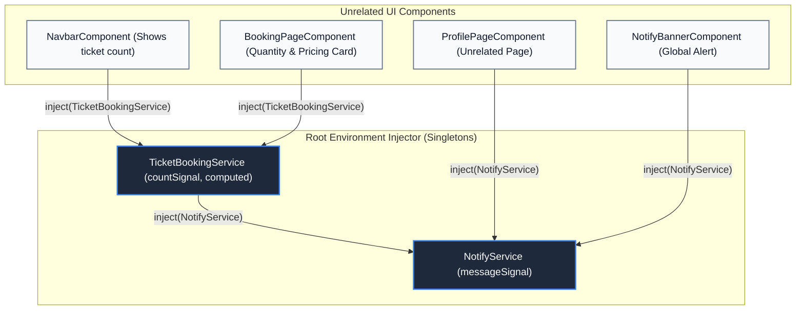
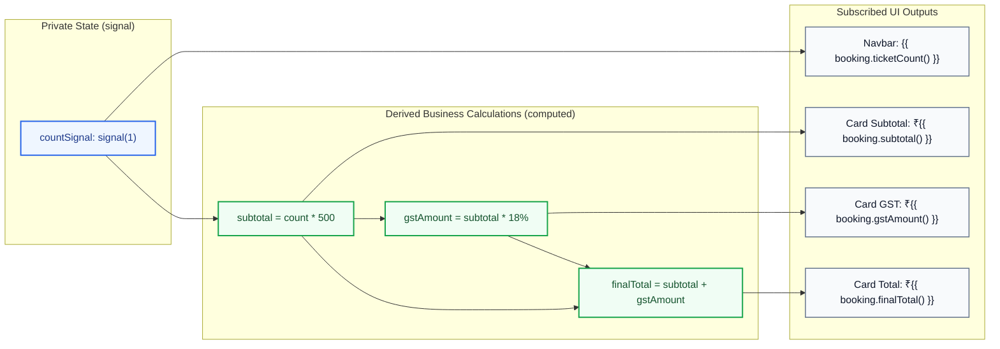
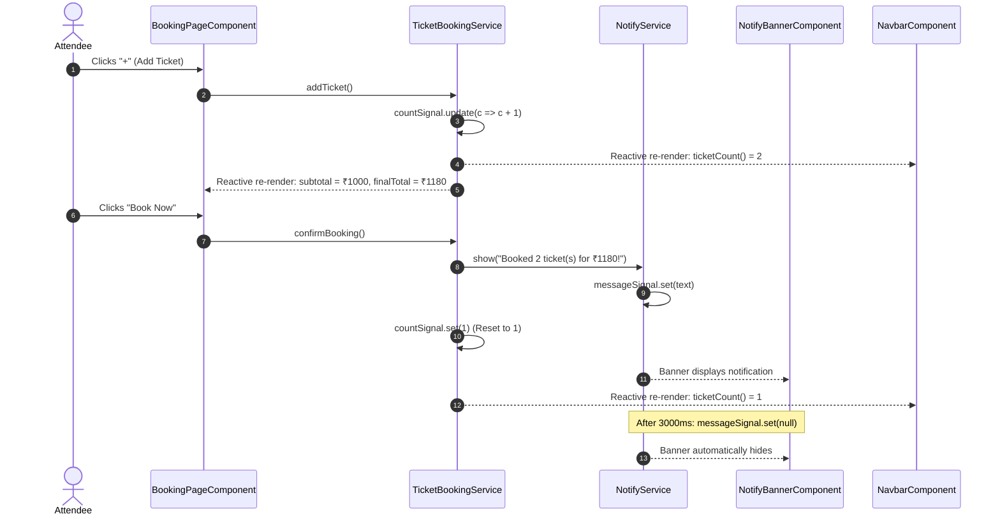

# Angular 22+ Shared Services Architecture (Ticket Booking Production Implementation)

> **Mandatory Instruction & Strict Version Adherence**  
> This project strictly adheres to **Angular version 22+** standards, conventions, and idioms. All implementations utilize modern **Standalone Components**, the function-based **`inject()` API**, native **Angular Signals (`signal()`, `computed()`, `.asReadonly()`)**, **OnPush change detection**, new control flow syntax (`@for`, `@if`), and zoneless-compatible testing with Vitest. Legacy decorators (such as constructor parameter injection, `NgModule`, or manual `@Input()` / `@Output()` chains for global state) are strictly avoided.

---

## Table of Contents

1. [Architectural Overview: What is a Shared Service?](#1-architectural-overview-what-is-a-shared-service)
2. [Why Shared Services are Required (Problems Without Them)](#2-why-shared-services-are-required-problems-without-them)
3. [How Dependency Injection Works in Angular 22+](#3-how-dependency-injection-works-in-angular-22)
4. [Foundation Level: Simple Notification Service (`NotifyService`)](#4-foundation-level-simple-notification-service-notifyservice)
5. [Production Level: Stateful Business Logic Service (`TicketBookingService`)](#5-production-level-stateful-business-logic-service-ticketbookingservice)
6. [Why This Pattern is So Clean (Core Architectural Principles)](#6-why-this-pattern-is-so-clean-core-architectural-principles)
7. [Flow Line & Sequence Diagrams](#7-flow-line--sequence-diagrams)
   - [Diagram 1: Component & Service Injection Topology](#diagram-1-component--service-injection-topology)
   - [Diagram 2: Reactive State & Computed Calculation Flow](#diagram-2-reactive-state--computed-calculation-flow)
   - [Diagram 3: Booking & Confirmation Flow](#diagram-3-booking--confirmation-flow)
8. [Complete Codebase Walkthrough](#8-complete-codebase-walkthrough)
   - [Notification Service (`notify.service.ts`)](#notification-service-notifyservicets)
   - [Notification Banner (`notify-banner.component.ts`)](#notification-banner-notify-bannercomponentts)
   - [Ticket Booking Shared Service (`ticket-booking.service.ts`)](#ticket-booking-shared-service-ticket-bookingservicets)
   - [Top Navbar Component (`navbar.component.ts`)](#top-navbar-component-navbarcomponentts)
   - [Booking Summary Card (`booking-page.component.ts`)](#booking-summary-card-booking-pagecomponentts)
   - [Arbitrary Triggering Page (`profile-page.component.ts`)](#arbitrary-triggering-page-profile-pagecomponentts)
   - [Application Shell & Configuration (`app.ts` & `app.config.ts`)](#application-shell--configuration-appts--appconfigts)
9. [Service Scoping Matrix: Root vs Route vs Component](#9-service-scoping-matrix-root-vs-route-vs-component)
10. [Advantages & Tradeoffs Analysis](#10-advantages--tradeoffs-analysis)
11. [Development, Testing & Verification Guide](#11-development-testing--verification-guide)

---

## 1. Architectural Overview: What is a Shared Service?

A **shared service** in Angular is an injectable TypeScript class decorated with `@Injectable({ providedIn: 'root' })` that acts as a **single source of truth** for common business logic, reactive state, or reusable utilities across multiple components and features.

In modern **Angular 22+**, shared services leverage:
1. **Dependency Injection (`inject()`)**: Replaces verbose constructor injection with composable, type-safe injection anywhere inside injection contexts.
2. **Angular Signals (`signal()`, `computed()`, `.asReadonly()`)**: Enables fine-grained reactivity without the overhead of manual subscription management, RxJS leak risks, or accidental zone-related performance bottlenecks.
3. **Encapsulated State Mutation**: Private writable signals prevent external consumers from directly corrupting data structures, exposing strictly read-only signals and explicit business methods.

---

## 2. Why Shared Services are Required (Problems Without Them)

Without shared services, components that live in different branches of the component tree (such as a top navigation bar and a booking summary card) have no clean way to share state or business rules.

### Without Shared Services (Prop Drilling & Duplication)

```
┌───────────────────────────────────────┐
│           AppRootComponent            │ <--- Forced to hold state it doesn't even use!
└──────────────┬─────────────────┬──────┘
               │ @Input()        │ @Input()
               ▼                 ▼
        ┌─────────────┐   ┌─────────────┐
        │   Navbar    │   │  Dashboard  │
        └─────────────┘   └──────┬──────┘
                                 │ @Input()
                                 ▼
                          ┌─────────────┐
                          │ TicketBadge │ <--- Needs ticket count from 3 levels up
                          └─────────────┘
```

### Real-World Pitfalls Avoided:
* **Prop Drilling**: Passing data through 4 or 5 intermediate parent components that do not even need the data just to reach a deeply nested child component.
* **Duplicated Business Rules**: Writing tax calculation, GST rate (18%), or ticket pricing (₹500) inside multiple separate components. When a rule changes, one component is updated while others calculate wrong numbers.
* **Out-of-Sync UI State**: When a user increments tickets in the booking card, the badge in the header fails to update because each component holds its own isolated copy of the data.
* **Bloated Components**: Components expand to hundreds of lines because they mix UI rendering with price calculations, timer logic, and business validations.

---

## 3. How Dependency Injection Works in Angular 22+

When a class is decorated with `@Injectable({ providedIn: 'root' })`, Angular creates **one singleton instance** of that service for the entire application and registers it in the **root environment injector**.

```
┌────────────────────────────────────────────────────────┐
│               Root Environment Injector                │
│  ┌──────────────────────────────────────────────────┐  │
│  │        TicketBookingService (Singleton)          │  │
│  └────────────────────────▲─────────────────────────┘  │
└───────────────────────────┼────────────────────────────┘
                            │ inject(TicketBookingService)
          ┌─────────────────┴──────────────────┐
          │                                    │
┌─────────┴─────────┐                ┌─────────┴─────────┐
│  NavbarComponent  │                │ BookingPageComponent│
└───────────────────┘                └───────────────────┘
```

* **Tree-Shakable by Default**: If no component, directive, or service invokes `inject(TicketBookingService)`, Angular's compiler removes the service from the final bundle.
* **Shared In-Memory State**: Every component calling `inject(TicketBookingService)` receives the exact same in-memory instance, meaning state mutations triggered in `BookingPageComponent` are instantaneously and reactively reflected in `NavbarComponent`.

---

## 4. Foundation Level: Simple Notification Service (`NotifyService`)

At the foundation level, a shared service encapsulates a focused, app-wide capability using a single string signal:
`[ Any Button ] ──► calls notify.show("Saved!") ──► [ Banner shows "Saved!" for 3s ]`

- **State (`messageSignal`)**: Holds current notification text (`string | null`).
- **Read-Only Exposure (`message`)**: Exposes `.asReadonly()` for templates to read reactively.
- **Auto-Dismissal**: Sets a 3-second timer to reset the message to `null`.

---

## 5. Production Level: Stateful Business Logic Service (`TicketBookingService`)

In production applications, shared services manage stateful business rules and derived calculations:
* **State (`countSignal`)**: Tracks selected ticket count (defaults to `1`).
* **Derived Business Logic (`computed()`)**:
  - `subtotal()` = `ticketCount * 500`
  - `gstAmount()` = `Math.round(subtotal * 0.18)`
  - `finalTotal()` = `subtotal + gstAmount`
* **Safe Actions**:
  - `addTicket()`: Increments ticket count.
  - `removeTicket()`: Decrements count (never below 1).
  - `confirmBooking()`: Calls `notify.show(...)` with the total price and resets count to 1.
* **Cross-Service DI**: `TicketBookingService` injects `NotifyService` to display booking confirmations.

---

## 6. Why This Pattern is So Clean (Core Architectural Principles)

1. **Zero Math in HTML or Components**:
   - Neither `NavbarComponent` nor `BookingPageComponent` knows that a ticket costs ₹500 or that GST is 18%.
   - All rules, constants, and math live exclusively in `TicketBookingService`.
2. **Automatic Reactive Updates**:
   - Clicking `+` inside `BookingPageComponent` updates `countSignal`.
   - Angular Signals automatically re-evaluate `subtotal()`, `gstAmount()`, `finalTotal()`, and the count displayed in `NavbarComponent` simultaneously.
3. **Immutability & Encapsulation**:
   - Components cannot write to signals directly (`countSignal.set(...)` is private).
   - State mutations can only happen through semantic, validated methods (`addTicket()`, `removeTicket()`).

---

## 7. Flow Line & Sequence Diagrams

### Diagram 1: Component & Service Injection Topology



---

### Diagram 2: Reactive State & Computed Calculation Flow



---

### Diagram 3: Booking & Confirmation Flow



---

## 8. Complete Codebase Walkthrough

### Notification Service (`notify.service.ts`)
[notify.service.ts](file:///d:/MyCode/My_GitHub/my-digital-space/Angular/concepts/Application_architecture/Shared_Services/src/app/core/services/notify.service.ts)
```typescript
import { Injectable, signal } from '@angular/core';

@Injectable({
  providedIn: 'root'
})
export class NotifyService {
  // Holds the current notification text (null = hidden)
  private readonly messageSignal = signal<string | null>(null);

  // Public read-only version for the HTML to read
  readonly message = this.messageSignal.asReadonly();

  show(text: string): void {
    this.messageSignal.set(text);
    // Hide automatically after 3 seconds
    setTimeout(() => {
      this.messageSignal.set(null);
    }, 3000);
  }
}
```

### Notification Banner (`notify-banner.component.ts`)
[notify-banner.component.ts](file:///d:/MyCode/My_GitHub/my-digital-space/Angular/concepts/Application_architecture/Shared_Services/src/app/shared/ui/notify-banner/notify-banner.component.ts)
```typescript
import { Component, ChangeDetectionStrategy, inject } from '@angular/core';
import { NotifyService } from '../../../core/services/notify.service';

@Component({
  selector: 'app-notify-banner',
  standalone: true,
  templateUrl: './notify-banner.component.html',
  styleUrl: './notify-banner.component.css',
  changeDetection: ChangeDetectionStrategy.OnPush
})
export class NotifyBannerComponent {
  // Inject the service so the HTML can read notify.message()
  protected readonly notify = inject(NotifyService);
}
```

### Ticket Booking Shared Service (`ticket-booking.service.ts`)
[ticket-booking.service.ts](file:///d:/MyCode/My_GitHub/my-digital-space/Angular/concepts/Application_architecture/Shared_Services/src/app/shared/data-access/ticket-booking.service.ts)
```typescript
import { Injectable, computed, inject, signal } from '@angular/core';
import { NotifyService } from '../../core/services/notify.service';

@Injectable({
  providedIn: 'root'
})
export class TicketBookingService {
  private readonly notify = inject(NotifyService);
  private readonly PRICE_PER_TICKET = 500;
  private readonly GST_RATE = 0.18;

  // 1. STATE: Tracks how many tickets are selected
  private readonly countSignal = signal<number>(1);
  readonly ticketCount = this.countSignal.asReadonly();

  // 2. DERIVED BUSINESS LOGIC: Automatically recalculates when countSignal changes
  readonly subtotal = computed(() => this.countSignal() * this.PRICE_PER_TICKET);
  readonly gstAmount = computed(() => Math.round(this.subtotal() * this.GST_RATE));
  readonly finalTotal = computed(() => this.subtotal() + this.gstAmount());

  // 3. ACTIONS: Safe methods to update the state
  addTicket(): void {
    this.countSignal.update((current) => current + 1);
  }

  removeTicket(): void {
    // Prevent going below 1 ticket
    if (this.countSignal() > 1) {
      this.countSignal.update((current) => current - 1);
    }
  }

  confirmBooking(): void {
    this.notify.show(`Booked ${this.ticketCount()} ticket(s) for ₹${this.finalTotal()}!`);
    this.countSignal.set(1); // Reset after booking
  }
}
```

### Top Navbar Component (`navbar.component.ts`)
[navbar.component.ts](file:///d:/MyCode/My_GitHub/my-digital-space/Angular/concepts/Application_architecture/Shared_Services/src/app/core/layout/navbar/navbar.component.ts)
```typescript
import { Component, ChangeDetectionStrategy, inject } from '@angular/core';
import { TicketBookingService } from '../../../shared/data-access/ticket-booking.service';

@Component({
  selector: 'app-navbar',
  standalone: true,
  templateUrl: './navbar.component.html',
  styleUrl: './navbar.component.css',
  changeDetection: ChangeDetectionStrategy.OnPush
})
export class NavbarComponent {
  protected readonly booking = inject(TicketBookingService);
}
```

### Booking Summary Card (`booking-page.component.ts`)
[booking-page.component.ts](file:///d:/MyCode/My_GitHub/my-digital-space/Angular/concepts/Application_architecture/Shared_Services/src/app/features/booking/booking-page.component.ts)
```typescript
import { Component, ChangeDetectionStrategy, inject } from '@angular/core';
import { TicketBookingService } from '../../shared/data-access/ticket-booking.service';

@Component({
  selector: 'app-booking-page',
  standalone: true,
  templateUrl: './booking-page.component.html',
  styleUrl: './booking-page.component.css',
  changeDetection: ChangeDetectionStrategy.OnPush
})
export class BookingPageComponent {
  protected readonly booking = inject(TicketBookingService);
}
```

### Arbitrary Triggering Page (`profile-page.component.ts`)
[profile-page.component.ts](file:///d:/MyCode/My_GitHub/my-digital-space/Angular/concepts/Application_architecture/Shared_Services/src/app/features/profile/profile-page.component.ts)
```typescript
import { Component, ChangeDetectionStrategy, inject } from '@angular/core';
import { NotifyService } from '../../core/services/notify.service';

@Component({
  selector: 'app-profile-page',
  standalone: true,
  templateUrl: './profile-page.component.html',
  styleUrl: './profile-page.component.css',
  changeDetection: ChangeDetectionStrategy.OnPush
})
export class ProfilePageComponent {
  private readonly notify = inject(NotifyService);

  onSave(): void {
    // One simple call updates the banner anywhere in the app
    this.notify.show('Profile saved!');
  }
}
```

### Application Shell & Configuration (`app.ts` & `app.config.ts`)
[app.ts](file:///d:/MyCode/My_GitHub/my-digital-space/Angular/concepts/Application_architecture/Shared_Services/src/app/app.ts) | [app.config.ts](file:///d:/MyCode/My_GitHub/my-digital-space/Angular/concepts/Application_architecture/Shared_Services/src/app/app.config.ts)
```typescript
// src/app/app.ts
import { Component, ChangeDetectionStrategy } from '@angular/core';
import { NavbarComponent } from './core/layout/navbar/navbar.component';
import { NotifyBannerComponent } from './shared/ui/notify-banner/notify-banner.component';
import { BookingPageComponent } from './features/booking/booking-page.component';
import { ProfilePageComponent } from './features/profile/profile-page.component';

@Component({
  selector: 'app-root',
  standalone: true,
  imports: [NavbarComponent, NotifyBannerComponent, BookingPageComponent, ProfilePageComponent],
  templateUrl: './app.html',
  styleUrl: './app.css',
  changeDetection: ChangeDetectionStrategy.OnPush
})
export class App {}
```

---

## 9. Service Scoping Matrix: Root vs Route vs Component

| Scope | How to Configure | Lifetime & Behavior | When to Use |
| :--- | :--- | :--- | :--- |
| **Root Singleton** | `@Injectable({ providedIn: 'root' })` | Created once upon first injection; lives for the lifespan of the browser tab/session. | Global notifications, ticket booking store, auth session, currency formatters. |
| **Route-Scoped** | `providers: [WizardService]` inside a route configuration | Created when entering the route; automatically destroyed when leaving the route. | Multi-step booking wizards where state should reset on navigate away. |
| **Component-Scoped** | `providers: [CounterService]` inside `@Component()` | A brand-new instance is created for each instance of that component and its subtree. | Reusable widgets (e.g. independent ticket counters on different stage tabs). |

---

## 10. Advantages & Tradeoffs Analysis

| Advantages | Disadvantages | Enterprise Mitigation |
| :--- | :--- | :--- |
| **Single Source of Truth**: Completely avoids out-of-sync badge counts and duplicate tax logic. | **Memory Retention**: Root singletons stay in memory until tab closure. | Clean up unnecessary data on booking completion (`countSignal.set(1)`). |
| **Thin Components**: Components contain zero math or calculation logic; purely handle presentation and bind to signals. | **Mutation Risks**: If writable signals are exposed, any component can modify values arbitrarily. | Strict encapsulation: private writable signals, public `.asReadonly()` exposures. |
| **High Testability**: Core business logic tests run in milliseconds without mounting DOM elements or HTML. | **Monolith Anti-Pattern**: Putting unrelated domains into one service. | Split domains into dedicated services (`TicketBookingService`, `NotifyService`). |

---

## 11. Development, Testing & Verification Guide

### 1. Build the Production Bundle
```powershell
npm.cmd run build
```

### 2. Run Comprehensive Unit Tests
The project features 100% test passing coverage using Vitest:
```powershell
npx.cmd ng test --watch=false
```

### 3. Start the Live Application
```powershell
npm.cmd start
```
Navigate to `http://localhost:4200` to interact with the Ticket Booking Counter and verify reactive updates across the Navbar and Booking Card.
